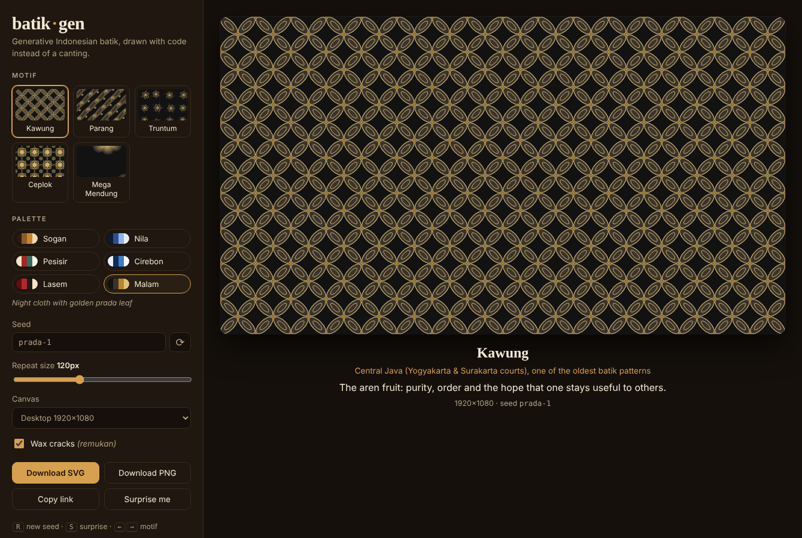
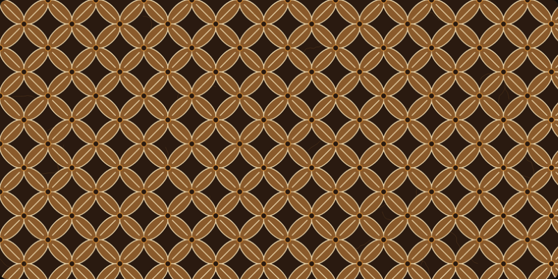
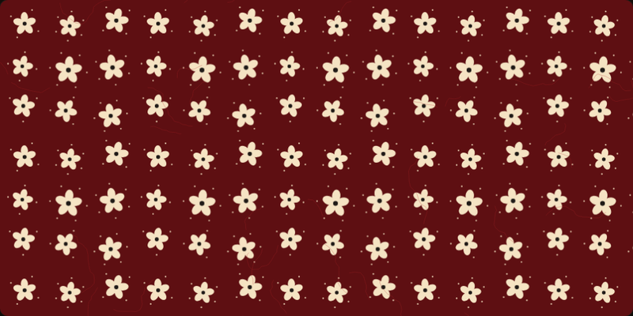
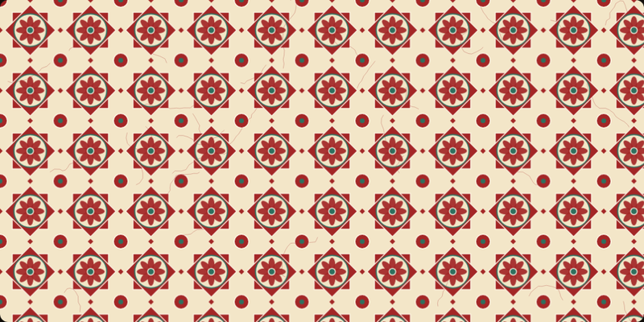
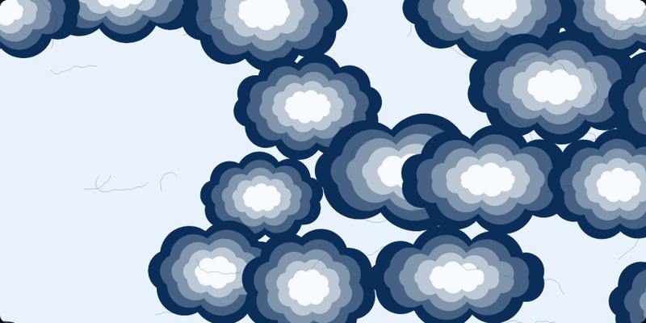

# batik·gen

**Generative Indonesian batik, drawn with code instead of a canting.**

Pick a traditional motif, a dye palette and a seed — batik-gen draws a seamless,
print-ready cloth as pure SVG. Same seed, same cloth: every design is a shareable link.

**Live demo:** https://epinnn14.github.io/batik-gen/



## Motifs

| | Motif | Origin | Meaning |
|---|---|---|---|
|  | **Kawung** | Yogyakarta & Surakarta courts | The aren palm fruit — purity and order |
|  | **Parang** | Mataram kingdom | Waves against rock — perseverance |
|  | **Truntum** | Surakarta, 18th century | Love that blooms again |
|  | **Ceplok** | Yogyakarta | Balance of the four directions |
|  | **Mega Mendung** | Trusmi, Cirebon | Rain clouds — patience under pressure |

## Features

- **5 motifs × 6 palettes** — Sogan, Nila (indigo), Pesisir, Cirebon, Lasem red and Malam (night & gold).
- **Seeded & deterministic** — a tiny `mulberry32` PRNG seeded by an FNV-1a hash; the seed changes proportions, ornaments (*isen*), petal counts and cloud layouts.
- **Wax cracks (*remukan*)** — optional random-walk veins that imitate dye seeping through cracked wax, on their own RNG stream so toggling them never changes the motif.
- **Seamless tiles** — Kawung, Parang, Truntum and Ceplok are SVG `<pattern>`s whose edges join perfectly; Mega Mendung is a full-canvas cloud field with 5–7 colour gradations.
- **Export** SVG (vector, infinitely scalable) or PNG in Desktop, Phone, Square or GitHub-banner sizes.
- **Shareable URL state** — everything lives in the hash, validated and clamped on load.
- **Keyboard**: `R` new seed · `S` surprise me · `←` `→` switch motif.
- **No runtime dependencies** — the generator is ~600 lines of plain TypeScript; Svelte 5 only drives the UI.

## Stack

[Svelte 5](https://svelte.dev) (runes) · TypeScript · Vite · Vitest · GitHub Actions → GitHub Pages

```
src/
├── lib/
│   ├── rng.ts          seeded PRNG + friendly random seeds
│   ├── palettes.ts     dye palettes, colour mixing, WCAG contrast
│   ├── svg.ts          tiny SVG string helpers
│   ├── motifs/         one generator per motif (pure functions → SVG markup)
│   ├── crackle.ts      wax-crack overlay
│   ├── render.ts       renderSvg(options) → standalone SVG document
│   ├── state.ts        URL hash <-> app state
│   └── export.ts       SVG / PNG download (browser only)
└── App.svelte          the control panel and preview
tests/                  Vitest: determinism, SVG well-formedness, palettes, URL state
```

## Run locally

```bash
npm install
npm run dev      # http://localhost:5173
npm test         # 31 tests
npm run build    # static site in dist/
```

## Use the generator in your own code

```ts
import { renderSvg } from './src/lib/render';

const svg = renderSvg({
  motif: 'parang', palette: 'nila', seed: 'lorod-2210',
  scale: 120, width: 1280, height: 640, crackle: true,
});
```

## Notes

The motifs are simplified, geometric interpretations made for fun and learning —
not reproductions of any specific cloth. Real batik tulis is drawn by hand with hot
wax and can take months; go buy some. 🇮🇩

## License

MIT © Alessandro Kevin Aprilio
