# batik·gen

**Generative Indonesian batik, drawn with code instead of a canting.**

Pick a traditional motif, a dye palette and a seed — batik-gen draws a seamless,
print-ready cloth as pure SVG. Same seed, same cloth: every design is a shareable link.

**Live demo:** https://epinnn14.github.io/batik-gen/


## Motifs

17 motifs from 7 island groups, west to east. Each island has its own folder in
[`src/lib/motifs/`](src/lib/motifs), and the app can filter by island.

### Sumatra

| | Motif | Region | Meaning |
|---|---|---|---|
| 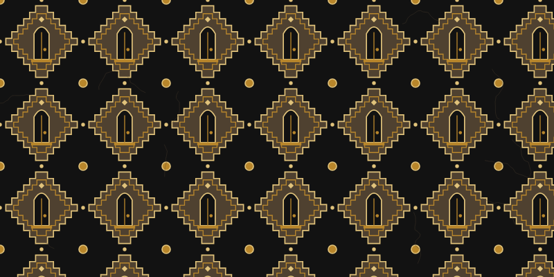 | **Pintu Aceh** | Aceh | The low door of the Rumoh Aceh — humility |
| 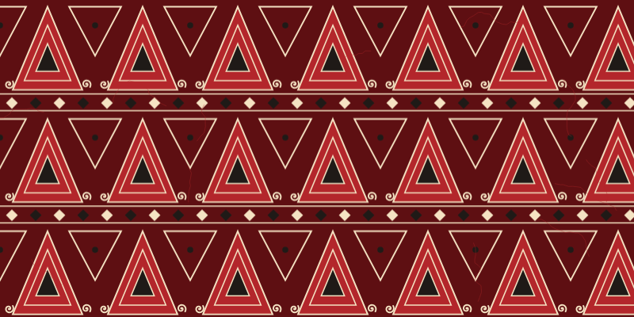 | **Pucuk Rebung** | Riau & West Sumatra | Young bamboo shoots — growth and hope |
| 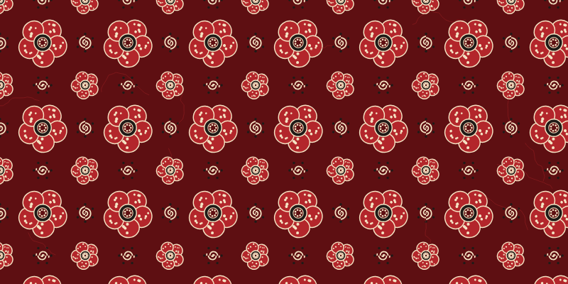 | **Besurek Rafflesia** | Bengkulu | Rafflesia and the unfurling fern — pride in the land |

### Jawa

| | Motif | Region | Meaning |
|---|---|---|---|
|  | **Kawung** | Yogyakarta & Surakarta courts | The aren palm fruit — purity and order |
|  | **Parang** | Mataram kingdom | Waves against rock — perseverance |
|  | **Truntum** | Surakarta, 18th century | Love that blooms again |
|  | **Ceplok** | Yogyakarta | Balance of the four directions |
|  | **Mega Mendung** | Trusmi, Cirebon | Rain clouds — patience under pressure |

### Kalimantan

| | Motif | Region | Meaning |
|---|---|---|---|
| 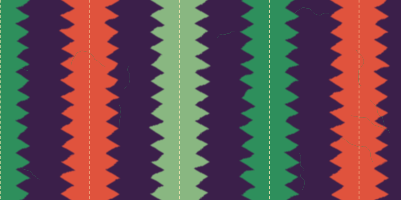 | **Sasirangan** | Banjarmasin, South Kalimantan | Tie-dyed "gigi haruan" zigzags — strength |
| 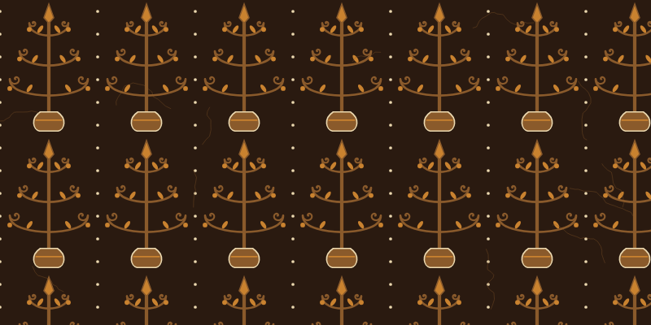 | **Batang Garing** | Central Kalimantan (Dayak Ngaju) | Tree of life joining the upper and lower worlds |

### Sulawesi

| | Motif | Region | Meaning |
|---|---|---|---|
| 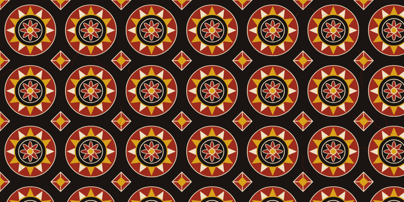 | **Pa' Barre Allo** | Tana Toraja | The sun carved on the tongkonan — blessing |
| 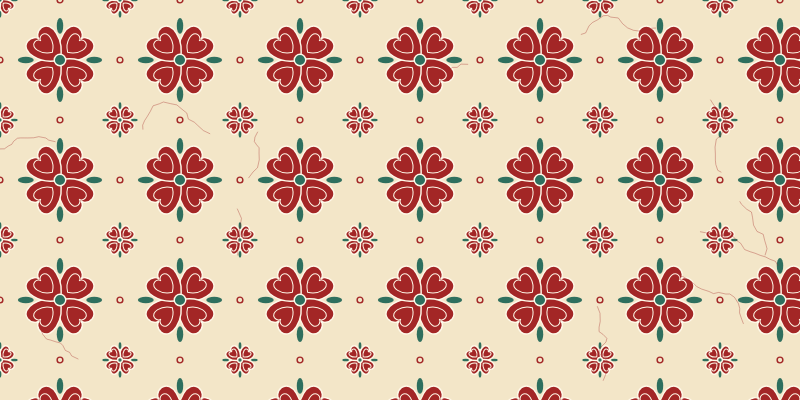 | **Bomba** | Palu (Kaili) | A blooming flower — friendship and welcome |

### Bali & Nusa Tenggara

| | Motif | Region | Meaning |
|---|---|---|---|
| 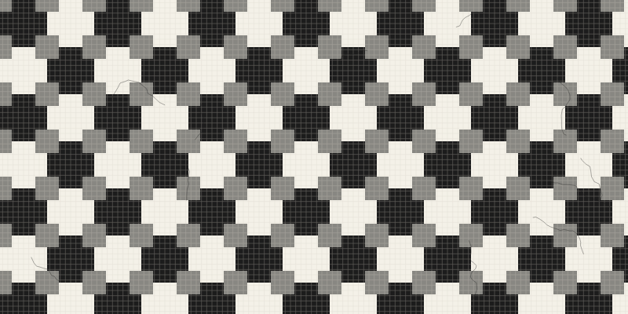 | **Poleng** | Bali | Rwa Bhineda — light and dark in balance |
| 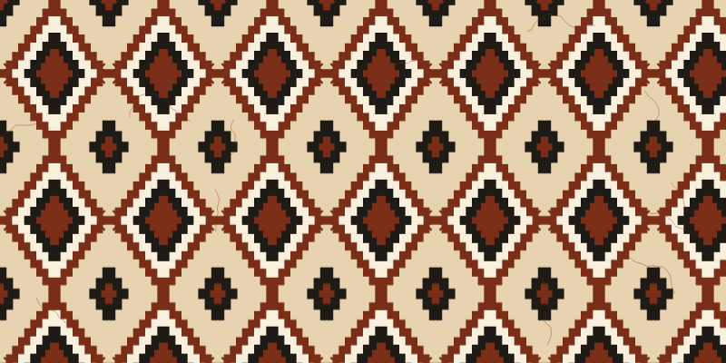 | **Ikat Belah Ketupat** | East Nusa Tenggara | Linked rhombi with hooks — kinship |

### Maluku

| | Motif | Region | Meaning |
|---|---|---|---|
| 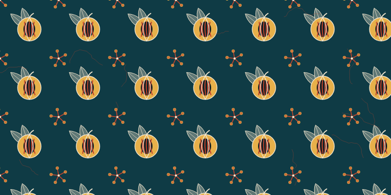 | **Pala & Cengkeh** | Banda, Ambon & Ternate | Nutmeg and clove — the Spice Islands' wealth |

### Papua

| | Motif | Region | Meaning |
|---|---|---|---|
| 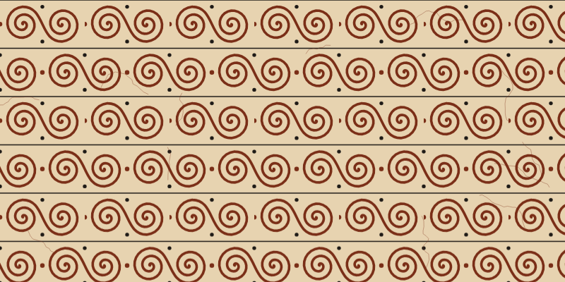 | **Sentani** | Lake Sentani, Jayapura | The linked "fouw" spiral — togetherness |
| 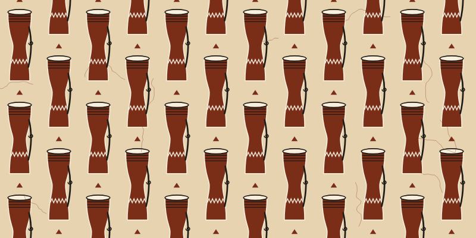 | **Tifa** | Papua | The drum that calls people together |

## Features

- **17 motifs × 11 palettes**: Sogan, Nila (indigo), Pesisir, Cirebon, Lasem red, Malam (night & gold), plus
  regional palettes Sasirangan, Toraja, Poleng, Laut Banda and Tanah Papua. Every motif suggests its own palette with one click.
- **Filter by island**: Sumatra, Jawa, Kalimantan, Sulawesi, Bali & Nusa Tenggara, Maluku, Papua.
- **Seeded & deterministic** — a tiny `mulberry32` PRNG seeded by an FNV-1a hash; the seed changes proportions, ornaments (*isen*), petal counts and cloud layouts.
- **Wax cracks (*remukan*)** — optional random-walk veins that imitate dye seeping through cracked wax, on their own RNG stream so toggling them never changes the motif.
- **Seamless tiles**: most motifs are SVG `<pattern>`s whose edges join perfectly, some with a half-drop repeat (Tifa, Sentani, Besurek).
  Mega Mendung is a full-canvas cloud field with 5–7 colour gradations. Sasirangan is drawn over the whole canvas too, because its
  turbulence "dye bleed" filter would show seams on a tile.
- **Export** SVG (vector, infinitely scalable) or PNG in Desktop, Phone, Square or GitHub-banner sizes.
- **Shareable URL state** — everything lives in the hash, validated and clamped on load.
- **Keyboard**: `R` new seed · `S` surprise me · `←` `→` switch motif (within the selected island).
- **No runtime dependencies**: the generator is plain TypeScript (~2,000 lines). Svelte 5 only drives the UI.

## Stack

[Svelte 5](https://svelte.dev) (runes) · TypeScript · Vite · Vitest · GitHub Actions → GitHub Pages

```
src/
├── lib/
│   ├── rng.ts          seeded PRNG + friendly random seeds
│   ├── palettes.ts     dye palettes, colour mixing, WCAG contrast
│   ├── svg.ts          tiny SVG string helpers
│   ├── motifs/         one generator per motif (pure functions → SVG markup)
│   │   ├── islands.ts  the 7 island groups, west to east
│   │   ├── sumatra/    pintu-aceh, pucuk-rebung, besurek
│   │   ├── jawa/       kawung, parang, truntum, ceplok, megamendung
│   │   ├── kalimantan/ sasirangan, batang-garing
│   │   ├── sulawesi/   barre-allo, bomba
│   │   ├── bali-nusa-tenggara/  poleng, ikat
│   │   ├── maluku/     pala-cengkeh
│   │   └── papua/      sentani, tifa
│   ├── crackle.ts      wax-crack overlay
│   ├── render.ts       renderSvg(options) → standalone SVG document
│   ├── state.ts        URL hash <-> app state
│   └── export.ts       SVG / PNG download (browser only)
└── App.svelte          the control panel and preview
tests/                  Vitest: determinism, SVG well-formedness, palettes, island registry, URL state
```

## Run locally

```bash
npm install
npm run dev      # http://localhost:5173
npm test         # 73 tests
npm run build    # static site in dist/
```

## Use the generator in your own code

```ts
import { renderSvg } from './src/lib/render';

const svg = renderSvg({
  motif: 'parang', palette: 'nila', seed: 'lorod-2210',
  scale: 120, width: 1280, height: 640, crackle: true,
});
```

## Add a motif

1. Create `src/lib/motifs/<island>/<motif>.ts` exporting a `Motif` (`id`, `name`, `island`, `region`,
   `origin`, `meaning`, optional `palette`, and `render()` returning SVG markup). The helpers in `src/lib/svg.ts`
   (`tile`, `spiral`, `steppedDiamond`, `ring`, `pts`) cover most shapes.
2. Add it to that island's `index.ts`.
3. `npm test`. Every motif is automatically checked for well-formed, deterministic SVG in every palette.

## Notes

The motifs are simplified, geometric interpretations made for fun and learning,
not reproductions of any specific cloth. Some regional motifs (Sasirangan, Poleng, ikat) come from tie-dye
or woven traditions rather than wax batik; today they are also made as batik, and they are included to show the
range of Indonesian textile design. Real batik tulis is drawn by hand with hot
wax and can take months; go buy some. 🇮🇩

## License

MIT © Alessandro Kevin Aprilio
